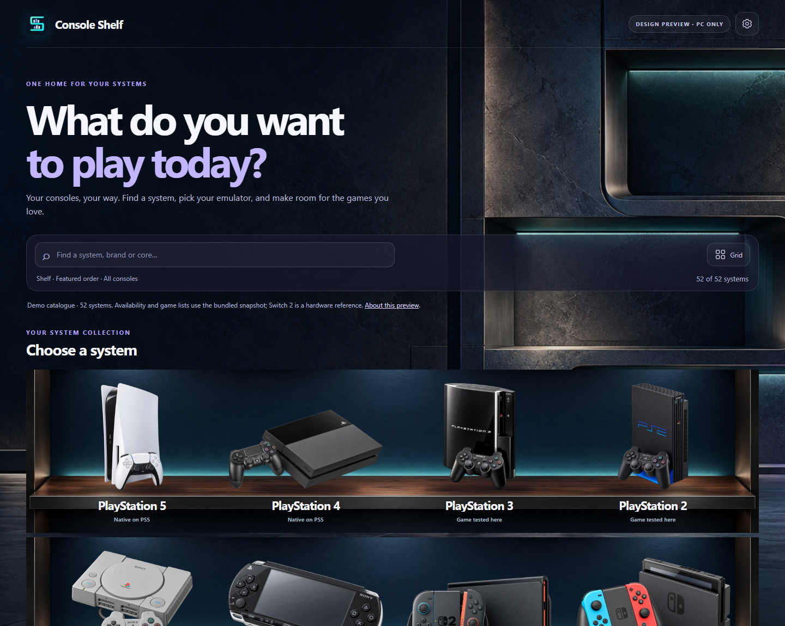
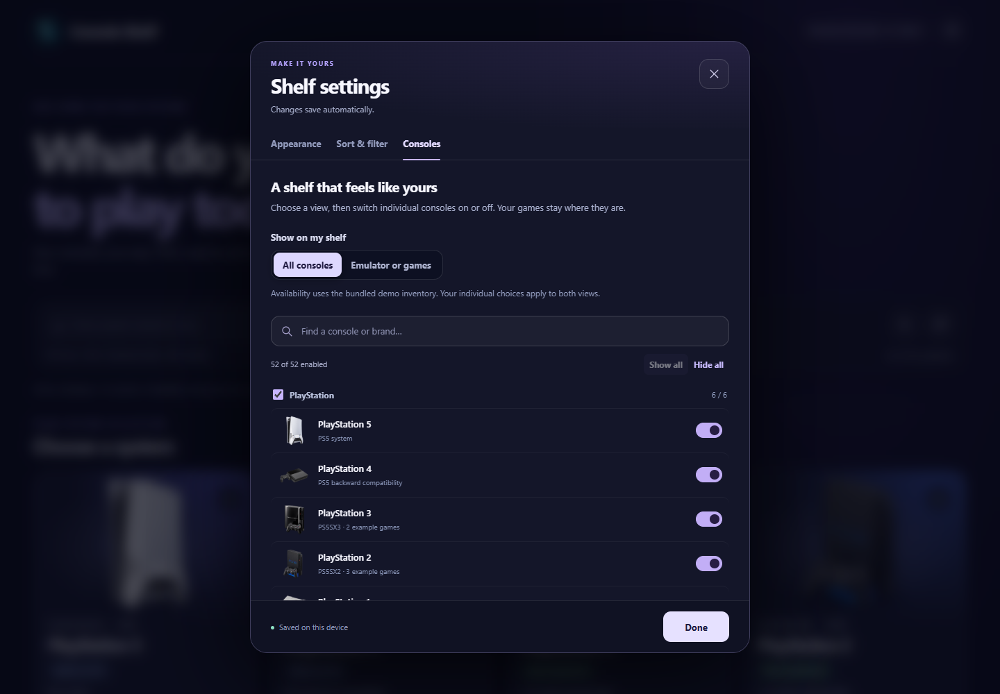
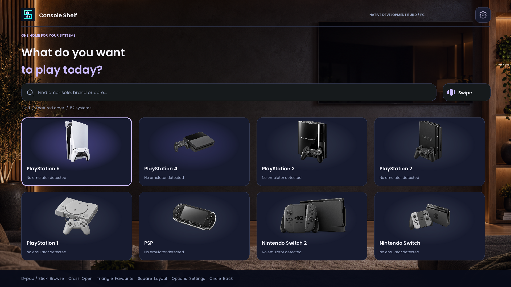

# Console Shelf

A console-first library project for PS5 homebrew. This repository contains a **browser design preview**, a **native C++/SDL development build for PC**, and a cross-compiled PS5 executable. The installable PS5 prototype is still in development. Open [index.html](index.html) for the design preview, or follow the [native build instructions](native/README.md). Both default to offline use. [Read-only PS5 library discovery](docs/DISCOVERY.md) and four initial launch routes were checked on the owner's firmware 12.20 console. The owner accepted the room, clock persistence, smaller handhelds and native video capability across earlier revisions. UI-21 adds original intro media for all 52 systems, personal overrides, a quieter menu backboard and fine-grain static. The owner confirmed its [distinct PS1/PS2/N64 intros and improved menu/static visuals](docs/verification/ui21-owner-room-checks-2026-10-25.json), plus [controls, three-second closure, saved choices and direct N64 launch](docs/verification/ui21-owner-controls-checks-2026-10-25.json). PC checks, raw console readbacks, exact source relinking and a clean source rebuild pass. The owner also confirmed the three standalone emulator menus and direct Final Fantasy Tactics through RetroArch. UI-22 adds persistent pre-launch explanations and fixes saved RetroArch choices; its PC checks pass. Installation and current-build console checks, including a normal restart, remain before the public prototype download.

## What works in the preview

- Browse 52 systems in Grid, a curved card-free Swipe carousel, or a lit display Shelf. Shelf places the console illustrations directly on deep walnut counters in one continuous gaming-lounge scene, with a subtle selection light. It pages through the collection instead of stretching a shelf photograph into each row. All layouts share sort, visibility and favourite choices. Grid can also use classic text cards.
- In Shelf, **L1/R1** (or Page Up/Down) swaps eight consoles at a time while the room stays still. **Sort & filter → Shelf pages** can instead show one curated display of up to eight consoles chosen in **Consoles**. All consoles, emulator/game availability, favourites, search and sorting apply to the collection. Small preview screens fit fewer systems per page.
- **Play room** settings customise the TV with selected-console artwork, original intro pictures and silent animations for all 52 systems, a personal PNG, a clock and Shelf logo, a personal message, or rotating favourite games. Personal intro clips and pictures take priority over the matching Shelf original. Mark a game with Triangle in the native library, or its star in the preview. TV content is clipped to the photographed screen with subtle glass reflections; the search bar ends before it. Intros can apply to installed emulators or all systems, and optional fine-grain static can mark missing emulators or games. [Room controls and personal media](docs/ROOM.md).
- Missing emulators use black-and-white console artwork by default. Appearance → Missing emulator artwork can keep everything in full colour instead. This does not hide systems or change launch support; the browser uses its dated demo inventory, while the native app uses discovery.
- In Swipe, the selected console sits forward in the centre; neighbours recede in size, depth and angle. Motion eases to a stop in 420 ms and retargets immediately when direction changes.
- Loop through Swipe using the stick/D-pad on a standard-mapped controller, keyboard arrows, mouse dragging or touch. Click a side console to centre it, then select the centre console to explore. The browser honours reduced-motion preferences and remembers the selected system. The owner has confirmed basic native PS5 controls; full controller acceptance remains pending. Automated controller checks are simulated.
- Switch between **All consoles**, **Emulator or games**, and **Favourites**. Availability uses recorded emulator routes, built-in PS5/PS4 routes, or example games in the preview; the native app uses real discovery. Choices persist on the device.
- Search, filter by brand or evidence level, sort in several ways, and save favorites.
- Open the settings gear for Appearance, Sort & filter, Consoles and Play room. Search the console picker, toggle individual systems or whole brands, and show/hide search results in one click. These choices persist on the device.
- Open a console detail page, choose a preferred emulator, and view example games. The emulator button is a preview action only.
- A persistent launch panel explains the action before selection: [Open emulator library](previews/launch-library-only.png) for menu-only routes, or [Play game](previews/launch-direct-play.png) for a direct RetroArch route. It follows the preferred emulator and stays on screen while browsing.
- Choose among three generated app icons for the preview header and browser tab.

See the [mobile Swipe view](previews/carousel-mobile.png) and [Switch 2 icon](previews/switch2-3d-card.png). Nintendo's press photo informed the Switch 2 illustration but is **not** displayed or bundled.

## Inventory and compatibility

The [demo system catalogue](docs/SYSTEMS.md) comes from a dated PS5 setup snapshot. Its 46 RetroArch core mappings and example game names are **not** a live scan of another user's console. A mapped core or listed emulator does not guarantee a game runs. In the browser demo, “Emulator or games” shows 51 of 52 cards; Switch 2 is the hardware-reference-only card and has no launch route. The native app instead starts empty and can use its [read-only scanner](docs/DISCOVERY.md) for the owner's actual inventory.

The next main milestone is a [native PS5 prototype and its first verified download](docs/PROTOTYPE-PLAN.md), targeting firmware 12.20. The [C++17 app](native/README.md) renders the console shelf, settings and discovered game lists, handles controller navigation and search, and saves preferences with recovery from a backup. Model, discovery, persistence, read-only FTP and simulated SDL controller tests pass on PC. The [PS5 executable cross-compiles](docs/PS5-BUILD.md), with native display/memory integration checked by host mocks and executable structure checks. The owner confirmed the grid and basic input; the current console journal records a complete configured-library scan with 92 games and 55 routes. Settings navigation and the closing fade are confirmed; the three-second hold is measured on the console. The selection background works, while opening still shows black before the shelf. The owner confirmed direct foreground opening of PSXS5, PS5SX2 and PS5SX3, plus Mario Party 3 through RetroArch, on the exact UI-15 build. Its source kit cold-relinks exactly. The new Shelf visual build and final settings/restart checks remain pending. No PS5 package is published here.

The native C++ renderer running on PC:

## Development check

The preview itself needs no build step. With Node.js and npm, run `npm ci` and `npm test` for the browser interaction and icon-integrity check. The test uses an installed Microsoft Edge when available; otherwise install Playwright's Chromium with `npx playwright install chromium`. Tests leave the checked-in screenshots alone; set `SHELF_CAPTURE_PREVIEWS=1` to regenerate them intentionally. Run `npm run test:native` for the native model using an existing Visual Studio C++ toolset on Windows, or a C++17 compiler on Linux. See [native build notes](native/README.md).

## Credits and license

The application source in this repository is [GPL-3.0](LICENSE). The generated icons have separate [image credits and reuse terms](assets/CREDITS.md). [Third-party project credits](THIRD_PARTY.md) distinguish incorporated GPL platform/build source, rendering dependencies and emulator references. No emulator binaries, games, ROMs, BIOS, keys, proprietary firmware/runtime files or user credentials are included. Console and game names are used for identification; this project is not affiliated with their manufacturers.
