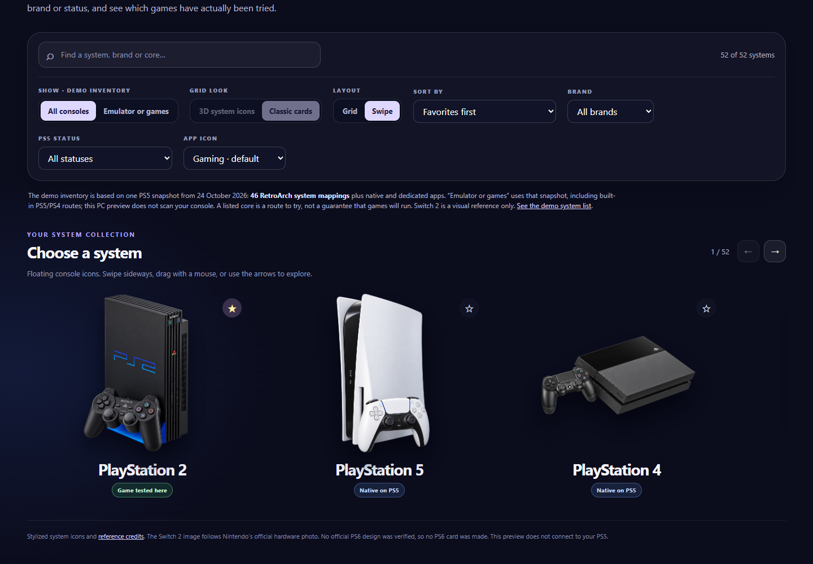

# Console Shelf

A console-first library concept for PS5 homebrew. This repository currently contains an **offline PC design preview**, not an installable PS5 app. Open [index.html](index.html) in a browser to try it; it does not connect to a console, launch games, or change firmware and network settings.

## What works in the preview

- Browse 52 console and platform cards in a Grid or a card-free, floating-icon Swipe view. Grid can use 3D-style system icons or classic text cards.
- Switch between **All consoles** and **Emulator or games**. The latter shows systems with a recorded emulator route, built-in PS5/PS4 route, or example game in the bundled demo inventory. The selection persists in the browser.
- Search, filter by brand or evidence level, sort in several ways, and save favorites.
- Open a console detail page, choose a preferred emulator, and view example games. The emulator button is a preview action only.
- Choose among three generated app icons for the preview header and browser tab.

See the [mobile Swipe view](previews/mobile-swipe.png) and [Switch 2 icon](previews/switch2-3d-card.png). Nintendo's press photo informed the Switch 2 illustration but is **not** displayed or bundled.

## Inventory and compatibility

The [demo system catalogue](docs/SYSTEMS.md) comes from a dated PS5 setup snapshot. Its 46 RetroArch core mappings and example game names are **not** a live scan of another user's console. A mapped core or listed emulator does not guarantee a game runs. In the demo, “Emulator or games” shows 51 of 52 cards; Switch 2 is the hardware-reference-only card and has no launch route. A future native build must replace the demo with each owner's actual emulator and game inventory.

Direct game launch, PS5 controller integration, on-console scanning and firmware compatibility testing are still in the [native integration plan](docs/INTEGRATION.md). No PS5 package is published here.

## Development check

The preview itself needs no build step. With Node.js and npm, run `npm ci` and `npm test` for the browser interaction and icon-integrity check. The test uses an installed Microsoft Edge when available; otherwise install Playwright's Chromium with `npx playwright install chromium`. Tests leave the checked-in screenshots alone; set `SHELF_CAPTURE_PREVIEWS=1` to regenerate them intentionally.

## Credits and license

The application source in this repository is [GPL-3.0](LICENSE). The generated icons have separate [image credits and reuse terms](assets/CREDITS.md). [Third-party project credits](THIRD_PARTY.md) name the open-source launchers and emulators studied as references; their source code and binaries are not bundled. No games, ROMs, BIOS, keys, firmware files or user credentials are included. Console and game names are used for identification; this project is not affiliated with their manufacturers.
