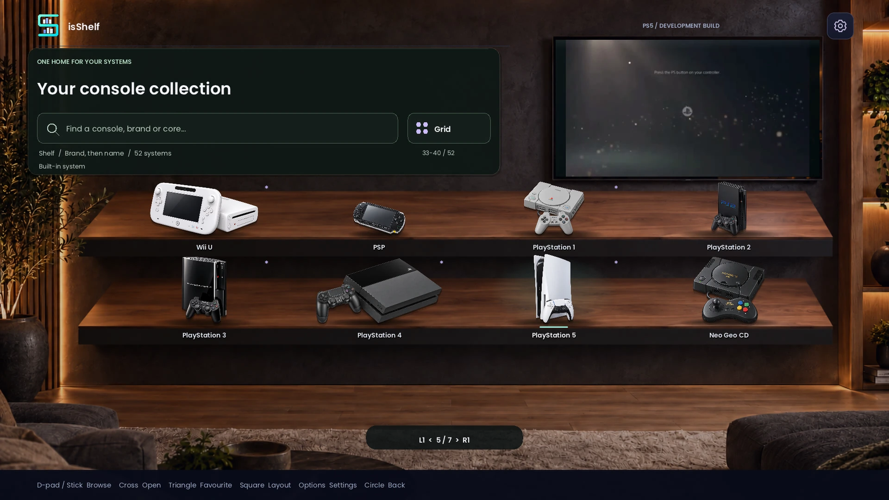
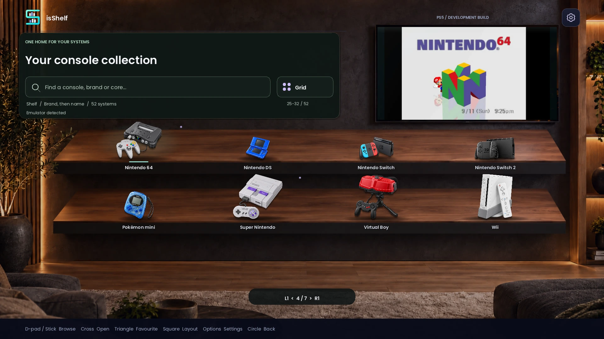
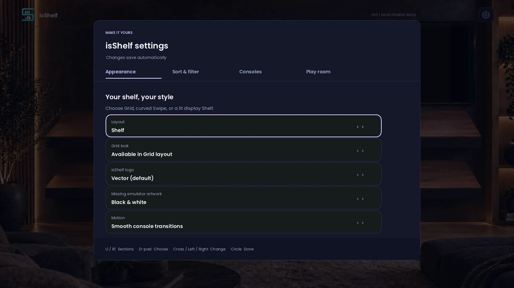
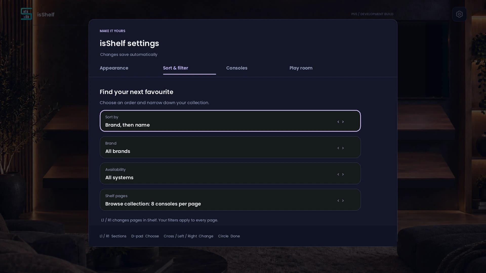
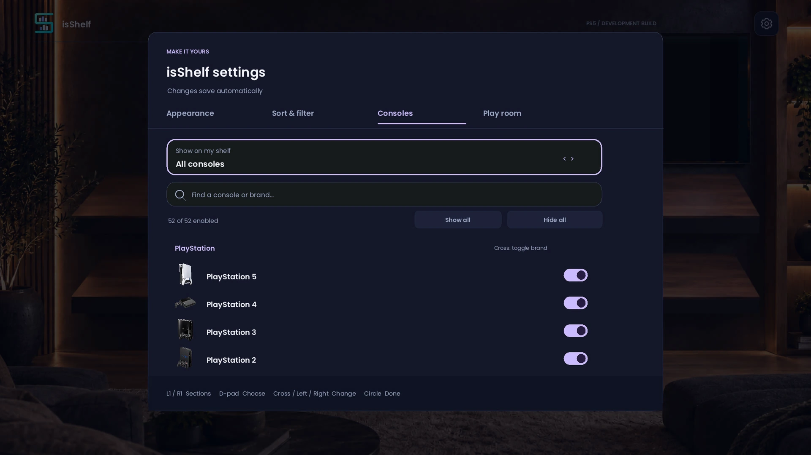
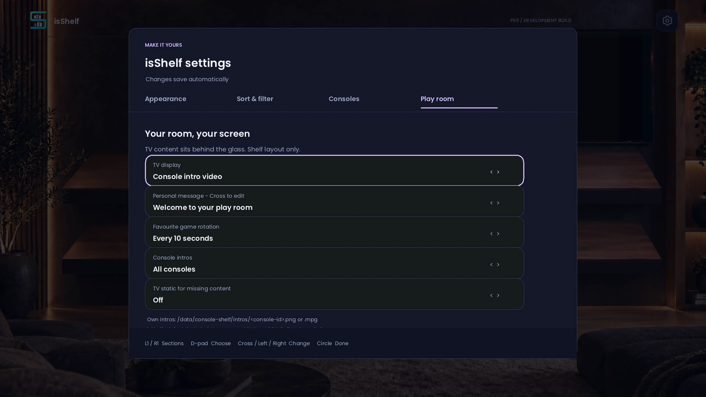

# isShelf on PS5

Captured by the owner using the PS5 Create controls on **26 October 2026**, running the first native beta on firmware **12.20**. These are console captures, not browser mockups. The game/emulator counts belong to this owner's setup.

Manufacturer startup videos visible inside the room TV are **personal overrides**. They are not included in isShelf downloads. The app bundles its own original animations. [Add your own TV media](PERSONAL-TV.md).

## Shelf room

The room stays still while L1/R1 changes the consoles on display.

## Appearance

Choose Grid, Swipe or Shelf, one of four logos, the optional black-and-white cue for missing emulators and smooth/reduced motion.

## Sort and filter

Sort the collection, narrow it by brand/availability and choose paged shelves or one curated display.

## Console visibility

Show all systems, only systems with emulator/game evidence, or your favourites. Individual switches let you tailor the collection further.

## Play room

Set the TV display, your message, favourite-game rotation, intro scope and optional static.

## Recording

[Watch a short PS5 room tour](images/ps5/shelf-tour.mp4). This silent excerpt is from the same owner's recording, with personal TV overrides visible. It demonstrates room navigation, not game compatibility.

The public images are resized WebP copies with capture metadata removed. The original JPEG XR screenshots and full recording stay on the owner's PC. [Media provenance and file hashes](images/ps5/manifest.json).

[Beginner's guide](BEGINNERS.md) · [Room customisation](ROOM.md) · [Download the beta](https://github.com/Iswebro/console-shelf-ps5/releases/tag/v0.1.0-beta.1)
